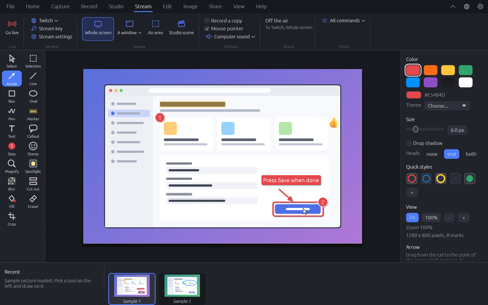
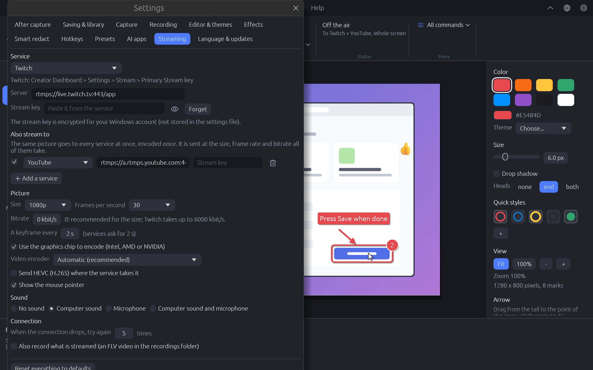
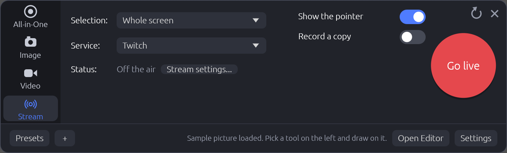
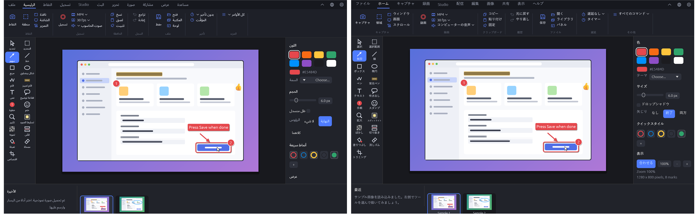

<div align="center">


# Snagster

**Capture your screen, mark it up, record it, share it.**

Windows · Mac · Linux · 86 languages · works offline · written in Rust · free and open source

[**⬇️ Windows**](https://github.com/SoloSaftis/Snagster/releases/latest/download/Snagster-windows-x64-portable.zip) &nbsp;·&nbsp;
[**⬇️ Mac**](https://github.com/SoloSaftis/Snagster/releases/latest/download/Snagster-macos-arm64.zip) &nbsp;·&nbsp;
[**⬇️ Linux**](https://github.com/SoloSaftis/Snagster/releases/latest/download/Snagster-linux-x86_64.AppImage)


</div>

## What it does

- **Capture anything** – press Print Screen, then drag an area or click a window, button or menu (or pick a window from a list). While you select, the window, button or panel under the pointer lights up: click to take it, turn the mouse wheel for the bigger part around it. Or the whole screen, all screens, a fixed size, or fun shapes: circle, lasso, star, heart.
- **Long pages** – scrolling capture scrolls by itself, keeps sticky headers once and stops at the end of the page, stitching a whole web page or document into one picture (sideways too).
- **Mark it up** – arrows, boxes, text in any of your fonts, speech bubbles, numbered steps, 1,300+ color emojis, highlighter, spotlight, magnifier, blur and smart redact for private details.
- **Tidy it up** – crop, cut out, move parts of the picture, borders, shadows, torn edges and more.
- **Linux, Wayland too** – on Wayland desktops and inside a Flatpak, a capture opens the desktop's own screenshot tool, and Studio, recording and live streaming use the desktop's screen sharing (you click Share once). Checked on Ubuntu 26.04 with GNOME; scrolling capture and the Print Screen hotkey need an X11 session for now.
- **Grab text** – copy the text out of any picture or part of the screen (Windows).
- **Record videos with sound** – MP4 (H.264 or HEVC) or WMV, 1 to 120 frames per second, with the computer's sound, your microphone or both (sound on Windows for now). The graphics chip does the encoding where it can (Intel Quick Sync, AMD or NVIDIA on Windows; VideoToolbox on Mac, checked on an Apple M1; VA-API for Intel and AMD and NVENC for NVIDIA on Linux, new and not yet tried on real hardware), so recording barely touches the processor or the battery. Snagster picks the best encoder by itself, or you choose one in Settings; if it can't start, Snagster quietly uses the best one that works. Videos go to your **Videos/Snagster** folder, pictures to **Pictures/Snagster**.
- **Studio mode** – a live recording and streaming studio: scenes made of screens, windows, screen areas, pictures, text and colours, arranged by dragging; each scene with its own sound (up to 6 sources: computer sound, microphones, music files) and a mixer with level meters; one-click recording or going live, and scene buttons (Ctrl+1–9) to switch scenes while on air, the sound fading across.
- **Go live** – stream the screen, a window, an area or a Studio scene to Twitch, YouTube, Kick, Facebook Live, Restream or your own RTMP server, up to 4K at 60 fps or 1080p at 120 fps where the service takes it. **Multistream** to up to five services at once from one encode, each with its own key and connection, so one slow or failing service never affects the others. A LIVE badge, automatic reconnecting, an encoder that takes over if the graphics chip's stops working, and an optional copy on disk. Your stream keys are kept encrypted (Windows), in the Keychain (Mac) or in a private file (Linux), never in the settings file. New in 0.10; not yet tried against the real services.
- **Record GIFs** that stay small, and step-by-step guides as PDF, Word or web pages.
- **Library** – every capture is kept, searchable by date, program and tags; works from your OneDrive or Dropbox folder.
- **Never stops answering** – saving, exporting, opening files and making guides all happen in the background, so the window stays quick even with big captures.
- **Everything you took, at hand** – the Recent strip lists this session's captures and the pictures and videos already on your computer, newest first. Settings and dialogs open in their own windows, and opening Snagster again brings the running one to the front (more than one at a time is a setting).
- **Your language** – 86 languages, picked automatically from your computer and changeable at any time; right-to-left languages read right to left.
- **A ribbon like Word's** – tabs for Home, Capture, Record, Studio, Stream, Edit, Image, Share, View and Help, every tool with an icon and an explanation when you point at it.
- **Keeps itself up to date** – Snagster checks for a new version once a day (you can turn it off) and installs it with one click.
- **For AI apps** – Snagster is an MCP server with 66 tools: Claude, ChatGPT, Cursor, VS Code and local AI (Ollama, LM Studio, llama.cpp through apps such as Open WebUI) can capture, mark up, read text, record videos, run Studio and go live.

**Your pictures stay on your computer.** No account, no ads, no tracking. Nothing is sent anywhere
(Snagster goes online only for the daily look for a new version, which you can switch off, and
when you start a live stream).

<div align="center">

<br><sub>Studio mode: build scenes from screens, windows, pictures and text, each with its own sound, then record or go live.</sub>
<br><br>

<br><sub>The Stream tab: switch scenes and mute sounds while you are live.</sub>
<br><br>

<br><sub>Multistreaming: Twitch and YouTube at once, from one encode.</sub>
<br><br>

<br><sub>The small capture panel goes live too.</sub>
<br><br>

<br><sub>86 languages, including right-to-left ones.</sub>
</div>

## Download

| Your computer | Download | Then |
|---|---|---|
| **Windows** 10 or 11 | [⬇️ Download for Windows](https://github.com/SoloSaftis/Snagster/releases/latest/download/Snagster-windows-x64-portable.zip) | Open the folder and double-click **Snagster** |
| **Mac** with Apple chip (M1 or newer) | [⬇️ Download for Mac](https://github.com/SoloSaftis/Snagster/releases/latest/download/Snagster-macos-arm64.zip) | Open it and drag **Snagster** to Applications. Then allow it under System Settings → Privacy & Security → **Screen Recording** |
| **Linux** | [⬇️ Download for Linux](https://github.com/SoloSaftis/Snagster/releases/latest/download/Snagster-linux-x86_64.AppImage) | Right-click → Properties → allow running as a program, then double-click it ([folder version](https://github.com/SoloSaftis/Snagster/releases/latest/download/Snagster-linux-x86_64-portable.tar.gz)) |
| **Linux, sandboxed** (Flatpak) | [⬇️ Download the Flatpak](https://github.com/SoloSaftis/Snagster/releases/latest/download/Snagster-linux-x86_64.flatpak) | Run `flatpak install --user Snagster-linux-x86_64.flatpak`, then start Snagster from your apps menu |

<details>
<summary><b>Your computer warns you the first time?</b></summary>

The app is not signed yet, so you may see a warning once:

- **Windows** says "Windows protected your PC": click **More info**, then **Run anyway**.
- **Mac** says Apple "could not verify" Snagster: click **Done**, open System Settings → Privacy & Security, scroll down and click **Open Anyway** next to Snagster.

</details>

All versions and what changed: [Releases](https://github.com/SoloSaftis/Snagster/releases).
After that, Snagster updates itself: **Help → Check for updates**.

## For AI apps

Snagster speaks MCP, the standard way for AI apps to use tools. **Settings → AI apps** in Snagster shows
every line below ready to copy, with the right path filled in.

<div align="center">

</div>

**Apps that start Snagster themselves** (Claude Desktop, Claude Code, Cursor, VS Code, Windsurf, Zed,
LM Studio, Jan, Cline, Continue, Goose...):

```sh
claude mcp add snagster -- "path/to/snagster" --mcp
```

```json
{ "mcpServers": { "snagster": { "command": "path/to/snagster", "args": ["--mcp"] } } }
```

**Apps that connect to a server** (Open WebUI, AnythingLLM, LibreChat, n8n, your own agent; this is how
local models from Ollama or llama.cpp reach Snagster): switch on **Settings → AI apps → Let AI apps on
this computer connect**, or run it without the window:

```sh
snagster mcp-http --port 45831
```

| Transport | Address |
|---|---|
| Streamable HTTP (current MCP) | `http://127.0.0.1:45831/mcp` |
| HTTP + SSE (older apps) | `http://127.0.0.1:45831/sse` |

The server only listens on this computer, refuses web pages from other sites, and can require a
password (`Authorization: Bearer ...`).

**What an AI can do** (66 tools): capture the screen, a window, an area or a scrolling page; read text;
add arrows, boxes, text, steps and blur; crop, resize and apply effects; undo and redo; save in every
format; make PDF, Word and web-page guides; search and add to the library; record videos with sound at
1–120 fps; set up and record Studio scenes; start, watch and stop a live stream (the saved stream key
is used and never shown); read and change settings; switch language; check for updates. Your AI app
lists every tool with what it does. It also offers ready-made prompts (annotate a screenshot, redact one, record a demo, make a
guide) and the current picture, settings and library as resources.

**From a terminal**, the same tools: `snagster help` lists commands such as
`snagster capture region 0 0 800 600 -o shot.png`, `snagster record 10 --fps 60 -o clip.mp4`,
`snagster ocr picture.png` and `snagster call list_languages`.

## Building it yourself

Snagster is one Rust program. With [Rust](https://rustup.rs) 1.88 or newer:

```sh
cargo build --release      # target/release/snagster
cargo test                 # the unit tests (no screen, sound card or network needed)
```

Linux needs a few development packages first (on Ubuntu:
`sudo apt install pkg-config clang libclang-dev libpipewire-0.3-dev libspa-0.2-dev libwayland-dev libxkbcommon-dev libgbm-dev libegl1-mesa-dev libgl1-mesa-dev libdrm-dev libxcb1-dev libxcb-randr0-dev libxcb-shm0-dev libxcb-xfixes0-dev libxcb-shape0-dev libdbus-1-dev nasm`).
What changed in each version: [CHANGELOG.md](CHANGELOG.md).

## How it's made

Snagster is written with an AI coding assistant (Claude). [`AI-DISCLOSURE.md`](AI-DISCLOSURE.md) lists which
parts are AI-generated and to what extent.

## Licence

[MIT](LICENSE-MIT) or [Apache-2.0](LICENSE-APACHE), at your option. A contribution you submit is
licensed the same way. Icons: [Phosphor](https://phosphoricons.com) (MIT). Fonts for other scripts:
[Noto](https://fonts.google.com/noto) (SIL Open Font License).
