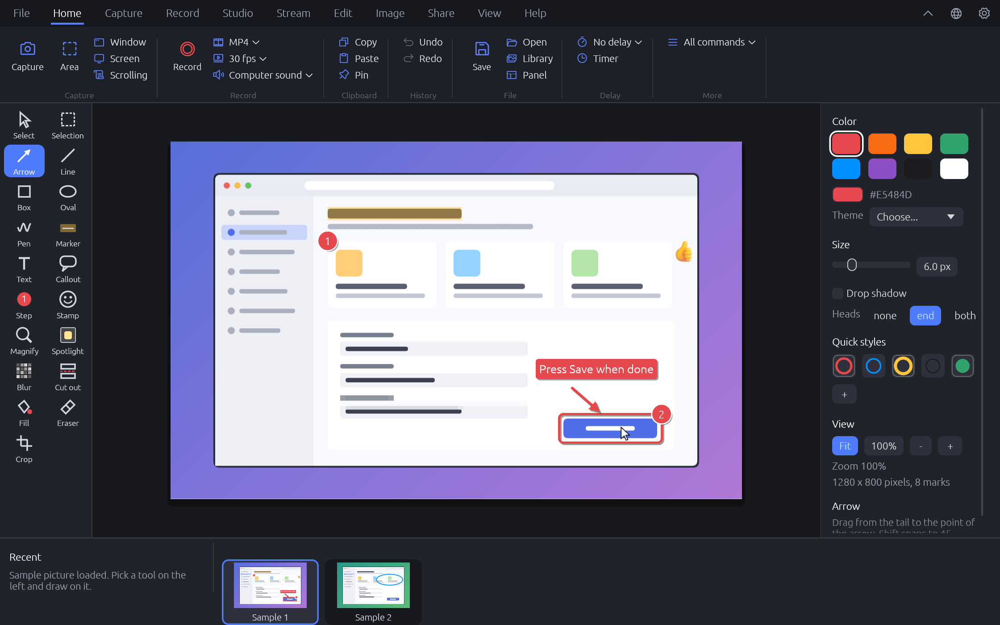
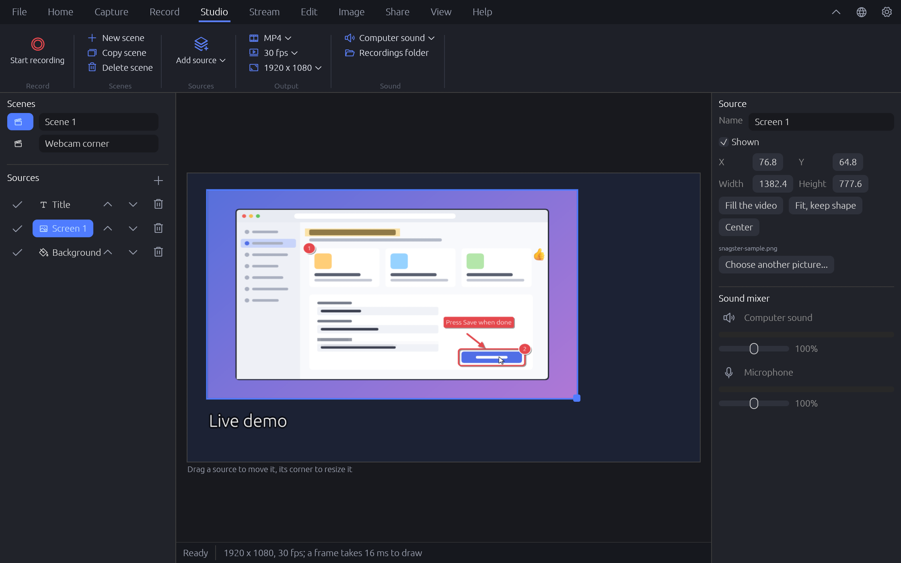
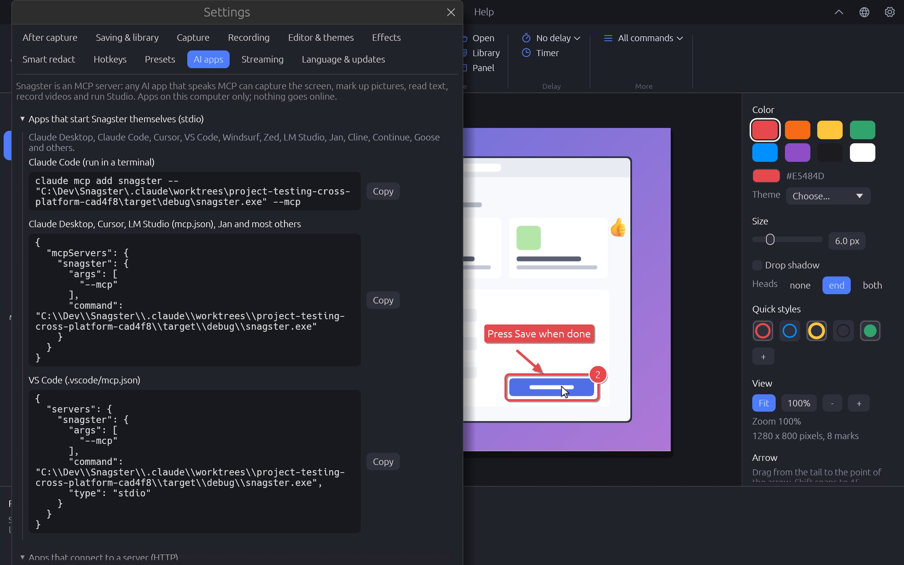

<div align="center">


# Snagster

**Capture your screen, mark it up, record it, share it.**

Windows · Mac · Linux · 86 languages · works offline · written in Rust · free and open source

[**⬇️ Windows**](https://github.com/SoloSaftis/Snagster/releases/latest/download/Snagster-windows-x64-portable.zip) &nbsp;·&nbsp;
[**⬇️ Mac**](https://github.com/SoloSaftis/Snagster/releases/latest/download/Snagster-macos-arm64.zip) &nbsp;·&nbsp;
[**⬇️ Linux**](https://github.com/SoloSaftis/Snagster/releases/latest/download/Snagster-linux-x86_64.AppImage)



</div>

## What it does

- **Capture anything** – press Print Screen, then drag an area or click a window, button or menu. Or the whole screen, all screens, a fixed size, or fun shapes: circle, lasso, star, heart.
- **Long pages** – scrolling and sideways capture stitch a whole web page or document into one picture.
- **Mark it up** – arrows, boxes, text in any of your fonts, speech bubbles, numbered steps, 1,300+ color emojis, highlighter, spotlight, magnifier, blur and smart redact for private details.
- **Tidy it up** – crop, cut out, move parts of the picture, borders, shadows, torn edges and more.
- **Grab text** – copy the text out of any picture or part of the screen (Windows).
- **Record videos with sound** – MP4 (H.264 or HEVC) or WMV, 1 to 120 frames per second, with the computer's sound, your microphone or both. On Windows the graphics chip does the encoding (Intel Quick Sync, AMD or NVIDIA), so recording barely touches the processor or the battery. Videos go to your **Videos/Snagster** folder, pictures to **Pictures/Snagster**.
- **Studio mode** – a live recording studio: scenes made of screens, windows, screen areas, pictures, text and colours, arranged by dragging, a sound mixer with level meters, and one-click recording.
- **Record GIFs** that stay small, and step-by-step guides as PDF, Word or web pages.
- **Library** – every capture is kept, searchable by date, program and tags; works from your OneDrive or Dropbox folder.
- **Your language** – 86 languages, picked automatically from your computer and changeable at any time; right-to-left languages read right to left.
- **A ribbon like Word's** – tabs for Home, Capture, Record, Studio, Edit, Image, Share, View and Help, every tool with an icon and an explanation when you point at it.
- **Keeps itself up to date** – Snagster checks for a new version once a day (you can turn it off) and installs it with one click.
- **For AI apps** – Snagster is an MCP server with 62 tools: Claude, ChatGPT, Cursor, VS Code and local AI (Ollama, LM Studio, llama.cpp through apps such as Open WebUI) can capture, mark up, read text, record videos and run Studio.

**Your pictures stay on your computer.** No account, no ads, no tracking. Nothing is sent anywhere
(the only time Snagster goes online is the daily look for a new version, which you can switch off).

<div align="center">

<br><sub>Studio mode: build a scene from screens, windows, pictures and text, then record it.</sub>
<br><br>

<br><sub>86 languages, including right-to-left ones.</sub>
</div>

## Download

| Your computer | Download | Then |
|---|---|---|
| **Windows** 10 or 11 | [⬇️ Download for Windows](https://github.com/SoloSaftis/Snagster/releases/latest/download/Snagster-windows-x64-portable.zip) | Open the folder and double-click **Snagster** |
| **Mac** with Apple chip (M1 or newer) | [⬇️ Download for Mac](https://github.com/SoloSaftis/Snagster/releases/latest/download/Snagster-macos-arm64.zip) | Open it and drag **Snagster** to Applications. Then allow it under System Settings → Privacy & Security → **Screen Recording** |
| **Linux** | [⬇️ Download for Linux](https://github.com/SoloSaftis/Snagster/releases/latest/download/Snagster-linux-x86_64.AppImage) | Right-click → Properties → allow running as a program, then double-click it ([folder version](https://github.com/SoloSaftis/Snagster/releases/latest/download/Snagster-linux-x86_64-portable.tar.gz)) |

<details>
<summary><b>Your computer warns you the first time?</b></summary>

The app is not signed yet, so you may see a warning once:

- **Windows** says "Windows protected your PC": click **More info**, then **Run anyway**.
- **Mac** says Apple "could not verify" Snagster: click **Done**, open System Settings → Privacy & Security, scroll down and click **Open Anyway** next to Snagster.

</details>

All versions and what changed: [Releases](https://github.com/SoloSaftis/Snagster/releases).
After that, Snagster updates itself: **Help → Check for updates**.

## For AI apps

Snagster speaks MCP, the standard way for AI apps to use tools. **Settings → AI apps** in Snagster shows
every line below ready to copy, with the right path filled in.

<div align="center">

</div>

**Apps that start Snagster themselves** (Claude Desktop, Claude Code, Cursor, VS Code, Windsurf, Zed,
LM Studio, Jan, Cline, Continue, Goose...):

```sh
claude mcp add snagster -- "path/to/snagster" --mcp
```

```json
{ "mcpServers": { "snagster": { "command": "path/to/snagster", "args": ["--mcp"] } } }
```

**Apps that connect to a server** (Open WebUI, AnythingLLM, LibreChat, n8n, your own agent; this is how
local models from Ollama or llama.cpp reach Snagster): switch on **Settings → AI apps → Let AI apps on
this computer connect**, or run it without the window:

```sh
snagster mcp-http --port 45831
```

| Transport | Address |
|---|---|
| Streamable HTTP (current MCP) | `http://127.0.0.1:45831/mcp` |
| HTTP + SSE (older apps) | `http://127.0.0.1:45831/sse` |

The server only listens on this computer, refuses web pages from other sites, and can require a
password (`Authorization: Bearer ...`).

**What an AI can do** (62 tools): capture the screen, a window, an area or a scrolling page; read text;
add arrows, boxes, text, steps and blur; crop, resize and apply effects; undo and redo; save in every
format; make PDF, Word and web-page guides; search and add to the library; record videos with sound at
1–120 fps; set up and record Studio scenes; read and change settings; switch language; check for
updates. It also offers ready-made prompts (annotate a screenshot, redact one, record a demo, make a
guide) and the current picture, settings and library as resources.

**From a terminal**, the same tools: `snagster help` lists commands such as
`snagster capture region 0 0 800 600 -o shot.png`, `snagster record 10 --fps 60 -o clip.mp4`,
`snagster ocr picture.png` and `snagster call list_languages`.

## For developers

Building, tests and how the code is laid out: [DEVELOPING.md](DEVELOPING.md).

## Licence

[MIT](LICENSE-MIT) or [Apache-2.0](LICENSE-APACHE), at your option. A contribution you submit is
licensed the same way. Icons: [Phosphor](https://phosphoricons.com) (MIT). Fonts for other scripts:
[Noto](https://fonts.google.com/noto) (SIL Open Font License).
